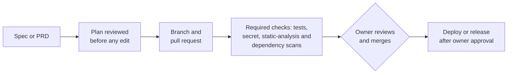

  <a href="https://bearingquest.com">
    <picture>
      <source media="(prefers-color-scheme: dark)" srcset="bearing-quest-lockup-on-dark.svg">
      
    </picture>
  </a>

<b>Security · Platform · Career tools</b>

Open-source projects from Dusten Harrison: security training, risk management and career tools, built with AI under human review. Bearing Quest is the name of this personal project family; the showcase is at [bearingquest.com](https://bearingquest.com).

| Project | What it is | Status |
| --- | --- | --- |
| [Risk Trainer](https://github.com/BearingQuest/risk-trainer) | A no-login web app that teaches security risk prioritization | Publicly hosted |
| [QuestVector](https://github.com/BearingQuest/questvector) | A local-first career-management CLI and desktop app | Proof of concept |
| [QuestCast](https://github.com/BearingQuest/questcast) | Daily X and LinkedIn post drafts from one recent source; nothing is published unless you ask | Personal use |
| [Bearing Register](https://github.com/BearingQuest/risk-register) | An open-source, GRC-as-code risk register | Planning stage |
| DossierNexus | Turns your own writing into career claims, each tied to the passage it came from | Planned; no repository yet |
| [project-template](https://github.com/BearingQuest/project-template) | The template new projects start from | Template |
| [bearingquest.github.io](https://github.com/BearingQuest/bearingquest.github.io) | The source of bearingquest.com | Live |

## How changes ship

Dusten specifies and directs each project. AI coding agents write the code under tested permission rules, and changes reach the main branch through pull requests that he reviews and merges.

Merges, releases, deploys and content approval are reserved for the owner.

[bearingquest.com](https://bearingquest.com) · [Signal Over Noise (blog)](https://dustenharrison.blogspot.com) · [LinkedIn](https://www.linkedin.com/in/dustenharrison)
